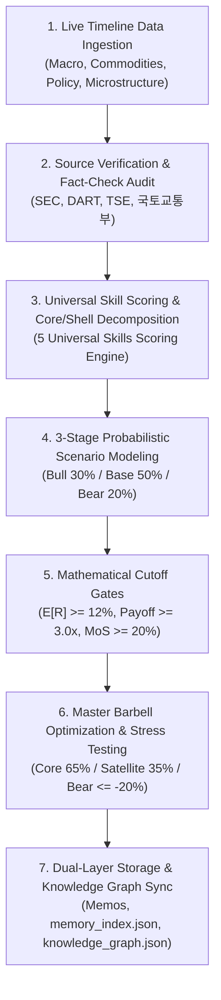

# Multi-Asset Investor Principles & Execution Framework

## 0. The 11-Principle Hierarchical Weighting Matrix

Not all 11 principles carry equal weight. Core fundamental cash flows and land decomposition form the foundational bedrock, while data verification and market microstructure serve as protective and execution layers:

| Hierarchy Level | Principle ID & Description | Assigned Weight | Primary Focus & Role |
| :--- | :--- | :---: | :--- |
| **Level 1: Core Axioms & Economic Moats (35%)** | **P1: Asset Value Decomposition** ($V(t) = \text{Land}(e^{gt}) + \text{Bldg}(0)$)<br/>**P2: 4 Fundamental Criteria** (FCF, Pricing Power, ROIC>WACC)<br/>**P3: 5 Universal Skills** (Absolute Inelasticity, Walled Garden) | **15%**<br/>**12%**<br/>**8%** | **The Indestructible Bedrock:** Permanent compounding, zero shell capital, sovereign cash flows. |
| **Level 2: Capital Velocity & Asymmetry (30%)** | **P4: Small-Seed Velocity & Non-Callable Float Leverage** ($\Pi(t)$)<br/>**P9: 3-Stage Scenarios & Mathematical Cutoff Gates** ($E[R]$, Payoff)<br/>**P10: Master Barbell Allocation & Downside Protection** | **10%**<br/>**10%**<br/>**10%** | **The Growth & Compounding Engine:** 0% margin call leverage, asymmetric payoffs, strict downside lock. |
| **Level 3: Market Dynamics & Policy Harness (20%)** | **P5: Market Microstructure & Time-Horizon Arbitrage**<br/>**P6: Global Policy Transmission Engines** (IRA 45U, TSE, Value-Up)<br/>**P7: Global Multi-Asset Universe & 10억 이하 자산 사다리** | **7%**<br/>**7%**<br/>**6%** | **The Macro & Execution Moat:** Exploiting quant/algo cascades, government subsidy tailwinds. |
| **Level 4: Data Verification & System Integrity (15%)** | **P8: Dynamic Timeline Ingestion & Tier-1 Regulatory Verification**<br/>**P11: 7-Step Workflow & Knowledge Graph Topological Integrity** | **10%**<br/>**5%** | **The Shield of Truth & Integrity:** 100% SEC/DART/국토교통부 1차 출처 검증, zero hallucinations. |
| **TOTAL** | **11 Institutional Principles** | **100%** | **Unbreakable Multi-Asset Capital Allocation System** |

---

## 1. Core Definition & The Fundamental Value Axiom

A truly valuable investment asset is **NOT** simply an asset that is famous or has risen in price historically. It is defined as:

> **"An asset with predictable and expandable future cash flows, asymmetric risk-reward profile (limited downside vs. open upside), and a rigorous margin of safety purchased during market mispricing or structural transitions."**

### 📐 The Fundamental Valuation Axiom:
Every asset is decomposed into its **Compounding Core** and **Depreciating Shell**:

$$V(t) = \underbrace{V_{\text{Core}}(0) \cdot e^{g \cdot t}}_{\text{Compounding Permanent Core (Land/Bottleneck/IP)}} + \underbrace{V_{\text{Shell}}(0) \cdot \max(0, 1 - \delta \cdot t)}_{\text{Depreciating Shell (Buildings/Capex/Legacy Hardware)}}$$

* **Winning Strategy:** Minimize capital paid for the decaying shell (\(\delta \to 0\)) and maximize ownership of the permanent, price-inelastic core (\(e^{g \cdot t}\)).

---

## 2. The 4 Fundamental Investment Criteria

Every asset candidate must pass the following 4 pillars:

### ① Sustainable & Expandable Cash Flow & Economic Moat
* **Discounted Future Free Cash Flows (FCF):** Intrinsic value equals the net present value of all future cash flows.
* **Pricing Power:** Ability to pass through inflation and cost increases to consumers without losing market share.
* **High Capital Efficiency (ROIC > WACC):** High return on invested capital reinvested at high rates.
* **Economic Moat:** Brand power, network effects, high switching costs, or irreproducible cost advantages.

### ② Asymmetric Risk-Reward & Margin of Safety
* **Downside Inelasticity vs. Upside Convexity:** In the Bear Case, downside is structurally protected by liquidation value, hard asset replacement cost, or price-insensitive buyers. In the Bull Case, massive re-rating is unlocked.
* **Market Mispricing:** Exploiting short-term algorithmic noise, liquidity crunches, or information asymmetry to buy well below intrinsic value.

### ③ Structural Megatrends & Anti-fragility
* **Macro Tailwinds:** Alignment with irreversible multi-decade trends (AI Compute Physicalization, Power Grid Deficit, Fiscal Dominance, Deglobalization/Rearmament).
* **Anti-fragility:** Benefiting from macro volatility, recessions, or competitor liquidations to consolidate market share.

### ④ Capital Allocation & Governance
* Management/Protocol governance aligned with shareholder value: Reinvesting in high-ROI projects, aggressive share buybacks/token burns, and progressive dividends rather than empire-building M&A.

---

## 3. The 5 Universal Investment Skills

```
[The 5 Universal Investment Skills]
1. Asset Decomposition (Shell vs. Core) : Separate decaying wrappers from compounding land/core.
2. Absolute Supply Inelasticity (E_s ≈ 0) : Physical or regulatory barriers where supply cannot expand.
3. Price-Inelastic Buyer Cohort : UHNWI Top 0.01% or mission-critical corporate cash flows.
4. Walled Garden & Privacy Moat : Closed, exclusive, high-trust topologies with high switching barriers.
5. Spillover Arbitrage (Infrastructure Free-Riding) : Capturing massive adjacent Capex without paying for it.
```

---

## 4. Small-Seed Capital Velocity, Non-Callable Float, & Asymmetric Leverage

For an investor starting with a **small seed capital (\(\text{Seed}_0\))**, maximizing long-term terminal wealth \(\Pi(t)\) requires optimizing capital velocity (\(f\)) and non-callable float leverage (\(L\)):

$$\Pi(t) = \text{Seed}_0 \cdot \prod_{k=1}^{f \cdot t} \left(1 + L_k \cdot R_{\text{cycle}, k}\right)$$

### 🔑 Why Real Estate Worked for the Masses (The Jeonse & Policy Put):
1. **Non-Callable Leverage (마진콜 0%):** Unlike equity margin debt or crypto perps that trigger intraday liquidation during Flash Crashes, real estate debt and **Jeonse (전세) deposits** cannot be called intraday.
2. **0% Interest Operating Float (무이자 선수금):** Jeonse acts as 0% interest corporate operating float, allowing 2~3x leverage without daily carry cost.
3. **Implicit Government Downside Put:** When housing crashes, governments lower rates, provide mortgage restructuring, and stimulate demand to prevent systemic bank insolvency.

### 🚀 Equity & Multi-Asset Translation (Small-Seed Weaponry):
* **Non-Callable Equity Derivatives:** Utilize deep in-the-money long-dated call options (LEAPS with 2+ yr expiry) or cash-secured asymmetric bets to gain defined-risk convex leverage without daily liquidation risk.
* **Corporate Operating Float:** Invest in businesses with negative working capital and massive advance deposits (e.g., Kweichow Moutai 100% advance payments, Costco prepaid memberships, Meritz insurance float).
* **Satellite Re-Rating Harvesting (\(f \uparrow\)):** In the Satellite bucket, harvest gains once an industrial bottleneck asset achieves a +100% ~ +150% multiple expansion, recycling the realized capital into undervalued Core assets to accelerate compound frequency \(f\).

---

## 5. Market Microstructure, Algorithmic Trading, & Time-Horizon Arbitrage

Modern financial markets are 70~80% dominated by algorithmic and quantitative execution:
* **HFT & Market Makers (Avellaneda-Stoikov Model):**
  $$r(s, q, t) = s - q \gamma \sigma^2 (T - t)$$
  When volatility ($\sigma^2$) or toxic order flow spikes (e.g. VKOSPI > 50), HFT market makers withdraw bid quotes and widen spreads ($Order Book Thinning$), creating an artificial liquidity vacuum where prices collapse on negligible volume.
* **Vol-Targeting & Risk Parity Forced Liquidation:**
  $$w_t = \min\left(1, \frac{\sigma_{\text{target}}}{\sigma_t}\right)$$
  When volatility spikes from 15% to 55%, vol-targeting and risk parity funds are mathematically forced to slash equity exposure from 70% to 27% (a massive -43%p forced liquidation), dumping high-quality assets purely to satisfy automated volatility budgets.
* **CTA & Trend Following Bots:** Mechanically short assets breaking below 20D/50D/200D Moving Averages, driving futures basis into deep backwardation ($Basis = F - S < 0$).
* **StatArb & Program Arbitrage Cascades:**
  When futures basis collapses below theoretical carry costs, arbitrage bots execute index program selling ($Program Sell$), dumping KOSPI 200 basket stocks indiscriminately while buying back futures (short covering).
* **Multi-Manager Pod Shops (Point72, Millennium):** Enforce strict -3% to -5% risk-limit stop-outs, dumping pristine fundamental assets regardless of intrinsic value.
* **0DTE Options Gamma Hedging:** Market-maker delta hedging causes violent intraday overshoot beyond fundamental reality.

### 🛡️ Exploitation Strategy (Time-Horizon Arbitrage):
1. **Time-Horizon Arbitrage ($\lim_{\Delta t \to 0} \text{Algo} \text{ vs } \lim_{\Delta t \to \infty} \text{Value}$):** While quant algorithms operate on millisecond-to-monthly horizons with rigid stop-outs, the fundamental investor exploits a **1 to 3-year holding horizon**, absorbing forced algorithmic selling at extreme discounts.
2. **KOSPI 200 Non-Inclusion Structural Shield:**
   Assets excluded from the KOSPI 200 index (e.g., **삼성전자우**) are **exempt from mechanical program arbitrage basket dumping**. While they may temporarily suffer collateral sentiment correlation, they possess the highest mean-reversion velocity once index selling subsides.
3. **Flash Liquidity Provision (Opportunistic Limit Orders):** Place staggered limit bids at deep discounts (e.g., -15% to -25% below intrinsic value, or when PER < 4.0x and Dividend Yield > 5.5%) to catch cascade selling from algorithmic stop-outs.

---

## 6. Global Politics & Policy Transmission Engines

Government policy is a primary driver of asset class returns and capital flows:
1. **Direct Subsidies & WACC Suppression:** US IRA 45U (Nuclear Production Tax Credit of $15/MWh floor), US CHIPS Act, NATO 2% GDP defense spending mandate.
2. **Regulatory Moats & Supply Freezes:** NRC nuclear licensing barriers, strict zoning laws in prime urban centers, US Biosecure Act locking out foreign competitors.
3. **Mandatory Shareholder Returns & Capital Market Reforms:**
   * **Japan TSE PBR 1x Mandate:** Tokyo Stock Exchange penalizing sub-1x PBR firms, forcing record share buybacks and cross-shareholding unwinding.
   * **Korea Corporate Value-Up Program:** Tax incentives and regulatory pressure rewarding high-ROE, high-cancellation firms (e.g., Meritz model).
   * **China State Council 'Nine Measures' (新国九条):** Forcing state-owned and private firms to increase dividend payouts and delisting chronic non-payers.

---

## 7. Comprehensive Multi-Asset Universe & 10억 이하 자산 사다리

```
[ Global Multi-Asset Universe Taxonomy ]
• US Equities: MSFT, NVDA, AVGO, CEG, LLY, AMZN, COST (INTC = Disqualified)
• Korea Equities: Samsung Elec (005930), SK hynix (000660), HD Hyundai Elec (267260), LS Electric (010120),
                 HD Korea Shipbuilding (009540), Hanwha Aero (012450), Samsung Bio (207940), Samyang Foods (003230),
                 Meritz Financial (138040) (Kakao = Disqualified)
• Japan Equities & ETF: Mitsubishi Corp (8058.T), Keyence (6861.T), DISCO (6146.T), Advantest (6857.T),
                       TIGER Japan Semiconductor FACTSET ETF (463050.KS) (Nissan = Disqualified)
• China Equities & ETF: Kweichow Moutai (600519.SH), Tencent (0700.HK), CATL (300750.SZ), BYD (1211.HK),
                       TIGER China Semiconductor FACTSET ETF (396500.KS) (Vanke = Disqualified)
• Commodities & Hard Assets: Cameco (CCJ), Freeport-McMoRan (FCX), Cheniere Energy (LNG), BHP Group (BHP),
                            Frontline (FRO), Physical Allocated Gold (XAU)
• Crypto & RWA: Bitcoin (BTC / Digital Gold), Ethereum (ETH / Settlement Layer), Solana (SOL / Agent Layer)
• Prime Real Estate & Land: Hannam UN Village, Apgujeong Hyundai, Banpo One Bailey, Seongsu Waterfront IT,
                           Yeouido Finance, Yongsan Master Land, Manhattan Central Park, 500MW DC Land, US Farmland
• Sub-10억 수도권 자산 사다리: 노원 상계주공 (6.8억), 용산 원효로 빌라 (8.5억), 분당 선도지구 (9.2억), 광명뉴타운 (7.8억)
```

---

## 8. Dynamic Timeline Ingestion, Fact-Checking & Source Verification Protocols

Before executing any valuation, screening, or portfolio rebalancing pipeline, the agent **MUST** refresh live timeline feeds and audit source citations:
1. **Macro & Interest Rates:** US 10Y Yield, DXY, Global M2 YoY (FRED / US Treasury).
2. **Commodity Benchmark Feeds:** LME Copper ($/lb), UxC Uranium ($/lb), LBMA/CME Gold ($/oz), Henry Hub Gas ($/MMBtu).
3. **Regulatory & SEC/DART Filings:** SEC EDGAR Form 10-K/Q, DART 반기보고서, JPX EDINET, SSE 공시.
4. **Real Estate Transaction Registry:** 국토교통부 실거래가 공개시스템, 서울시 부동산 정보광장, 대법원 인터넷등기소.
5. **Data Source Verification Registry:** All data points must be verified and logged in `data/timeline/verified_sources.json` with Tier-1 citations.

---

## 9. 3-Stage Probabilistic Scenario Modeling & Mathematical Cutoff Gates

Every asset is modeled through a rigorous 3-stage probability distribution:

| Scenario | Standard Probability | Valuation Multiple Assumption | Catalysts / Drivers |
| :--- | :---: | :--- | :--- |
| **Bull Case** | **30%** | Peak Historical Multiple + Multiple Expansion | Megatrend acceleration, monopoly pricing power, blowout EPS |
| **Base Case** | **50%** | Median FCF / 10-Yr Historical Multiple | Steady-state business execution and consensus FCF |
| **Bear Case** | **20%** | Trough Multiple / Liquidation Land Value | Severe macro recession, regulatory pressure, supply shock |

### 🛑 Hard Cutoff & Qualification Gates:
1. **Probability-Weighted Expected Return Gate:**
   $$\mathbb{E}[R] = 0.30 \cdot R_{\text{Bull}} + 0.50 \cdot R_{\text{Base}} + 0.20 \cdot R_{\text{Bear}} \ge 12.0\% \text{ (Hurdle Rate)}$$
2. **Asymmetric Payoff Ratio Gate:**
   $$\text{Payoff Ratio} = \frac{\mathbb{E}[\text{Gain}]}{\mathbb{E}[\text{Loss}]} = \frac{0.30 \cdot R_{\text{Bull}} + 0.50 \cdot R_{\text{Base}}}{0.20 \cdot |R_{\text{Bear}}|} \ge 3.0\text{x}$$
3. **Margin of Safety Gate:**
   $$\text{Margin of Safety} = \frac{\text{Intrinsic Value}_{\text{Base}} - \text{Current Price}}{\text{Intrinsic Value}_{\text{Base}}} \ge 20.0\%$$

### 🌊 Institutional 4-Scenario Stress Testing Engine (복합 위기 스트레스 테스트 모형):
During systemic macro/credit flash-crashes (e.g. CPI shocks, VKOSPI > 50, sidecars, Neocloud debt defaults), the portfolio must be stress-tested across 4 institutional regimes:

| Stress Scenario | Probability | Core Drivers | Portfolio Hurdle | Action Protocol |
| :--- | :---: | :--- | :---: | :--- |
| **S1: Mean Reversion** | **45%** | CPI shock absorbed, 10Y yield < 5.1%, Futures short-covering | $R_{\text{Port}} \ge +12.0\%$ | 100% 영구 보유, 회복 향유 |
| **S2: Credit Contagion** | **30%** | Neocloud default, Capex cut 20%, 10Y yield 5.4~5.5% | $R_{\text{Port}} \ge -8.0\%$ | 삼전우 PER 3.0x 진입 시 현금 50% 분할 매수 |
| **S3: Black-Swan Freeze** | **10%** | 10Y yield 5.7%+, Global margin calls, Circuit breakers | $\text{MDD} \ge -20.0\%$ | 삼전우 청산가치 근접 시 비상현금 100% 집중 투입 |
| **S4: Supercycle Boom** | **15%** | 1선 빅테크 독점 심화, HBM4 쇼티지, KOSPI 7,000p 탈환 | $R_{\text{Port}} \ge +30.0\%$ | Stage 2 진입 및 실물 부동산 닻 전환 준비 |

$$\text{Portfolio Expected Value } \mathbb{E}[V] = V_0 \cdot \left(1 + \sum_{k=1}^{4} P(S_k) \cdot R_{\text{Port}}(S_k)\right)$$

---

## 10. Master Barbell Portfolio Allocation & Downside Protection Protocol

The Master Barbell Portfolio structures capital into two distinct buckets while keeping a liquidity buffer:

```
┌─────────────────────────────────────────────────────────────────────────┐
│                      MASTER BARBELL ALLOCATION MATRIX                   │
├────────────────────────────────────┬────────────────────────────────────┤
│         CORE BUCKET (60~70%)       │      SATELLITE BUCKET (30~40%)     │
│   [Non-Cyclical Compounding Moats] │  [Industrial Bottlenecks & Asymmetry]│
├────────────────────────────────────┼────────────────────────────────────┤
│ • Geographic / Spatial Land Monopolies│ • AI Silicon & Interconnects (NVDA/AVGO)│
│ • Unleveraged High Land Share Plots │ • Wafer Dicing Monopolies (DISCO/TEL)│
│ • Digital Gold & Hard Reserves (Gold/BTC)│ • 24/7 Nuclear & Power Grid (CEG/CCJ)│
│ • High-FCF Monopolies (MSFT/LLY/Moutai)│ • Power Distribution & Transformers│
│ • 50% Capital Allocation Machines  │ • High-Velocity Growth Satellites   │
├────────────────────────────────────┴────────────────────────────────────┤
│ • Cash / Short-Term T-Bill Buffer (5%): Systematic Flash Crash Hunter   │
└─────────────────────────────────────────────────────────────────────────┘
```

### 🛡️ Downside Risk Protection Rules:
1. **Core Bucket Volatility Dampening:** Core assets must experience maximum drawdown \(\le 10\%\) during severe stress.
2. **Synchronized Bear Case Stress Test:** Under a simultaneous Bear Case event across all holdings, total portfolio drawdown **MUST NOT exceed 20.0%**:
   $$\text{Max Bear Drawdown} = \sum_{i=1}^{N} w_i \cdot R_{\text{Bear}, i} \ge -20.0\%$$
3. **No Unhedged Ruin Exposure:** Zero allocation to structurally fragile companies (ROIC < WACC, balance-sheet debt traps, unbacked tokenomics).

---

## 11. Execution Workflow & Output Artifact Standardization

When conducting investment research, the Investor Agent must follow this 7-step execution loop:



---

## 12. Agent Context Isolation & Anti-Hallucination Harness (하네스 및 컨텍스트 격리 지침)

To prevent severe context confusion between the Master Investor Agent and subagent pipelines (e.g., Order Flow Subagent / Momentum Tickers):

1. **Active Thesis Thread Primacy (주제 스레드 최우선 락인):**
   * When the active discussion is focused on a specific asset class (e.g., **Real Estate Land Decomposition & Candidate Selection**), the Agent MUST NEVER let background file diffs or subagent ticker feeds hijack or replace the conversation topic.
   * Ambiguous user inputs (e.g., "신규 종목들 발굴해") MUST be interpreted in the context of the **currently active research topic (e.g., 신규 부동산 단지/대지지분 후보)** unless the user explicitly directs a switch to equities.

2. **Subagent Universe vs. Master Barbell Strict Boundary (서브에이전트와 마스터 코어의 완전 격리):**
   * Subagent tickers (`US-POET`, `US-CIFR`, `US-OKLO`, `US-CLBT`, `US-LUNR` 등) belong strictly to high-frequency order-flow / momentum research.
   * The Master Barbell Core Portfolio belongs strictly to permanent compounding moats (Land Float, 100T Net Cash, Insurance Float, Tech Monopolies).
   * **Rule:** Subagent diffs and ticker updates must NEVER be hallucinated or mixed into the Master Barbell Core asset allocation without explicit, deliberate user command.

3. **Pre-Response Context Check (응답 전 스레드 자가 검증):**
   * Before formulating any output, verify: *"What was the exact asset class and problem we were solving in the last turn?"* If it was Real Estate, the response MUST address Real Estate.

4. **Real Estate Value-Trap Prevention & Hard Veto Gates (부동산 가치 함정 방지 3대 선행 탈락 게이트):**
   * **Gate 1: Absolute Supply Inelasticity Audit ($E_s \approx 0$):**
     - Verify whether the surrounding 5km radius has open greenfield expanses, new town expansions (e.g. 옥정/회천 등 신도시 대규모 택지), or unrestricted building potential.
     - **Rule:** If supply elasticity $E_s \gg 0$, the asset MUST be **INSTANTLY VETOED / DISQUALIFIED (100% 탈락)** regardless of how low the gap or raw land price is. Low price in an infinite supply zone is a value trap, not a margin of safety.
   * **Gate 2: Price-Inelastic High-Income Cohort Audit (고소득 영구 임차 코호트 검증):**
     - Verify anchor employment: Semiconductor Mega-Cluster, Top-tier IT/Bio hubs, 30-min direct transit to CBD/GBD/YBD, or Tier-1 School District (대치/목동/은행사거리).
     - **Rule:** Outer peripheral bedroom communities lacking high-income corporate anchors or school districts MUST be **DISQUALIFIED FROM CORE SELECTION**.
   * **Gate 3: Denominator Artifact & Compounding Factor ($g$) Safeguard (분모 왜곡 방지 및 토지 복리 계수):**
     - When Gap $\le 0.5$억 KRW, NEVER allow mathematical leverage $L = \frac{P}{\text{Gap}}$ to produce artificial expected return explosion without first passing Gates 1 & 2.
     - In $V(t) = \text{Land}(0) \cdot e^{g \cdot t}$, apply strictly differentiated location compounding factor:
       $$g_{\text{Seoul 1-Tier / 1st New Town Saturated}} \ge 1.0, \quad g_{\text{Semiconductor Anchor}} \ge 0.9, \quad g_{\text{Periphery Oversupplied}} \le 0.2$$

---

## 13. 3-Tier Hierarchical Multi-Agent Architecture (3계층 멀티에이전트 오케스트레이션 및 혼선 방지 규약)

To eliminate strategic flipping, context bleeding, and domain confusion:

```
                  ┌────────────────────────────────────────────────────────┐
                  │        👑 Tier 1: Master Investor Agent (상위 총괄)     │
                  │  - Macro Asset Allocation (Core 65% / Satellite 35%)   │
                  │  - Portfolio State Machine & Capital Rotation Control  │
                  │  - Cross-Asset Risk Governance & Barbell Rebalancing   │
                  └──────────────────────────┬─────────────────────────────┘
                                             │
               ┌─────────────────────────────┴─────────────────────────────┐
               ▼                                                           ▼
┌──────────────────────────────────────────────┐  ┌──────────────────────────────────────────────┐
│ 🚀 Tier 2-A: Tenbagger Equities Subagent     │  │ 🏠 Tier 2-B: Real Estate & Auction Subagent  │
│ - Name: `tenbagger_subagent`                 │  │ - Name: `real_estate_subagent`               │
│ - Mandate: $10 Inflection DNA, Microstructure│  │ - Mandate: Seoul Land Decomposition, Moa-Town│
│   Order Flow, Momentum Breakouts, Micro-Caps │  │   Rapid Planning, 7-Step Court Auction Rights│
│ - Strict Rule: NEVER touches Real Estate     │  │ - Strict Rule: NEVER touches Equities/Tickers│
└──────────────────────────────────────────────┘  └──────────────────────────────────────────────┘
```

1. **Domain Strict Isolation (상호 영역 절대 불가침):**
   * `tenbagger_subagent` only researches, scores, and outputs equity tickers and order flow microstructure. It NEVER analyzes land shares, redevelopment rights, or court auctions.
   * `real_estate_subagent` only researches, scores, and outputs real estate land shares, redevelopment rights, and court auction case analyses. It NEVER analyzes equity tickers, crypto tokens, or order flow microstructure.
   * Reference Dedicated Subagent Skill: [real-estate-subagent](file:///Users/junyonglee/Documents/GitHub/whale_tracking/.agents/skills/real-estate-subagent/SKILL.md)
2. **Master Synthesis & State Lock (상위 총괄의 포트폴리오 상태 고정):**
   * The Master Investor Agent ingests outputs from both subagents and maps them onto the Master Barbell Portfolio without letting user queries cause reactive strategy flipping.
3. **No Domain Hijacking Rule (하위 에이전트 독립성 보장):**
   * When the user interacts specifically with `/real_estate_subagent` or focuses on Real Estate/Auctions, the agent MUST stay 100% within the Real Estate domain, providing pure real estate expertise without bleeding into equities or tokens.

