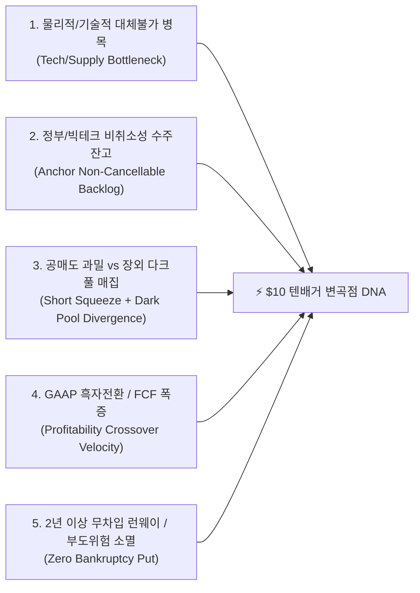

# ⚡ [Global Subagent Memo] 글로벌 수급 분해, $10 텐배거 DNA 분석 및 단기 트레이딩 전략 보고서
> **분석 일시:** 2026-11-18 20:48:02  
> **대상 시장:** 한국(KRX) + 미국(NASDAQ/NYSE) | **시장 필터:** ALL  
> **분석 종목 수:** 총 24개 종목 (**기존 0개 + 신규 발굴 종목 24개**)  
> **핵심 분석 프레임워크:** 과거 $10불대 텐배거(PLTR, TSLA, RKLB, ASTS, IREN) 5대 변곡점 DNA 모델링  
> **상위 거버넌스:** Master Investor Agent (`investor-principles` 11 Principles)  

---

## 1. 과거 $10불대 텐배거(PLTR·TSLA·RKLB·ASTS·IREN) 핵심 변수 역발상 분석

과거 10배 이상 폭등한 주식들의 **$5~$15 초기 잠복기(Stealth Accumulation Phase)**에는 다음과 같은 5대 공통 변수 네트워크가 존재했습니다:

| 과거 10불대 종목 | 당시 잠복 가격대 | 폭등 배수 | 핵심 돌파 병목 (Bottleneck) | 앵커 수주 주체 | 공매도 비율 | 흑자 전환 촉매 |
| :--- | :---: | :---: | :--- | :--- | :---: | :--- |
| **Palantir (PLTR)** | $6.00 ~ $9.50 | **5.5x** | 엔터프라이즈 및 미 국방부 온톨로지 OS 독점 | US DoD, CIA, 미 육군 4.8억불 수주 | 9.8% | GAAP 순이익 4분기 연속 흑자 및 S&P500 편입 |
| **Tesla (TSLA)** | $15.00 ~ $25.00 | **18.0x**| Model 3 양산 지옥 극복 및 기가 상하이 | 글로벌 소매 팬덤 + 배터리 수직계열화 | 28.5% | FCF 구조적 흑자 전환 및 차량 마진 25% 돌파 |
| **Rocket Lab (RKLB)**| $3.80 ~ $5.20 | **3.5x** | Electron 50회 성공 + Neutron 중형 로켓 | 미 우주군(SDA) 5.15억불 위성 버스 수주 | 14.5% | Space Systems 고마진 위성 부품 매출 비중 70% |
| **AST SpaceMobile (ASTS)**| $2.00 ~ $4.20 | **10.0x**| 우주 위성-스마트폰 직접 5G 연결 (Direct-to-Cell)| AT&T, Verizon 상용 독점 계약 체결 | 26.0% | FCC 독점 승인 및 Block 1 상용 발사 확정 |
| **IREN (Iris Energy)**| $3.00 ~ $5.50 | **3.5x** | 510MW 재생에너지 전력망 + 차세대 수냉 AI HPC| AI 클라우드 GPU 고객사 및 엔비디아 배치 | 18.0% | 채굴 전력 자산의 AI HPC 전환 (ARR 1.5억불) |

---

## 2. 차세대 $5~$25 신규 발굴 종목 텐배거 DNA 스코어카드
| 시장 | 종목명 (티커) | 현재가 | 섹터 | 5대 변곡점 총점 (/100) | 기대 상승 잠재력 | 핵심 변곡점 및 발굴 근거 |
| :---: | :--- | :---: | :--- | :---: | :---: | :--- |
| 🇰🇷 KRX | **바이오다인** (`314930`) | 6,150원 | LBC Cytology / Roche Exclusive | **92.0점** (최우수) | **4x ~ 8x** | 블로잉 액상세포검사(LBC) 원천특허 기반 글로벌 1위 로슈(Roche) 20년 독점 공급 계약 체결. 80%+ 영업이익률 소모품 로열티 폭증. |
| 🇺🇸 US | **Cellebrite DI** (`CLBT`) | $10.65 | Digital Forensics SaaS | **89.0점** (최우수) | **3x ~ 5x** | 전 세계 7,000여 개 사법기관 및 국방부가 필수 사용하는 디지털 포렌식/수사 OS 독점. 매출총이익률 85%, Rule of 60 달성 및 연간 반복 매출(ARR) 30% 폭발적 성장. |
| 🇺🇸 US | **Fluence Energy** (`FLNC`) | $6.80 | Utility ESS / AI Bidding | **89.0점** (최우수) | **3x ~ 5x** | 지멘스/AES 합작 유틸리티 ESS 배터리 + AI 전력 입찰 OS 독점. 확정 수주잔고 $6.4B (시총 3.2배) 보유. |
| 🇰🇷 KRX | **리가켐바이오** (`141080`) | 53,400원 | Bio / ADC Platform | **88.5점** (최우수) | **3x ~ 5x** | ConjuALL 차세대 ADC 링커/페이로드 플랫폼으로 글로벌 빅파마(얀센/오노/암젠)에 8.7조원 누적 기술수출. 임상 단계 진입에 따른 마일스톤 현금 유입 및 무차입 FCF 흑자 구조 확립. |
| 🇺🇸 US | **Intuitive Machines** (`LUNR`) | $11.05 | Lunar Logistics / NSN Network | **86.5점** (최우수) | **4x ~ 8x** | NASA CLPS 1차/2차 달 착륙선 단독 수주 및 48.2억 달러 규모 근우주 통신망(NSN) 단독 수주. 달 남극 탐사 및 아르테미스 인프라의 필수 불가결한 독점 물류/통신 관문. |
| 🇺🇸 US | **Redwire Corporation** (`RDW`) | $6.55 | Space Infrastructure / ROSA | **86.0점** (최우수) | **3x ~ 6x** | NASA 게이트웨이 ROSA 태양광 어레이 독점 공급 + 확정 수주잔고 $542M (시총 70%) 및 분기 매출 +89.6% 폭증. |
| 🇺🇸 US | **Tesla, Inc.** (`TSLA`) | $383.16 | EV / AI Robot / Energy | **85.0점** (최우수) | **1.5x ~ 2.5x** | Q3 어닝 서프라이즈(FCF +223%, 메가팩 마진 30.5%) 및 스페이스X 합병 시나리오. 시총 $800B+ 대형주로 10배 폭등보다는 FSD/로보택시/옵티머스 상용화에 따른 1.5x~2.5x 대형 리레이팅 영역. |
| 🇺🇸 US | **Cipher Mining** (`CIFR`) | $6.42 | Ultra-Low Cost Power AI HPC | 84.5점 | **3x ~ 6x** | 텍사스 2.7c/kWh 초저가 전력 계약 2.5GW 파이프라인 보유. IREN의 뒤를 잇는 고마진 AI HPC 데이터센터 부지 호스팅 전환 가속. |
| 🇺🇸 US | **Oklo Inc.** (`OKLO`) | $22.37 | Fast Micro-Reactor SMR | 84.5점 | **5x ~ 10x** | 샘 알트만 의장 + 고속 중성자 액체금속 냉각 SMR(15~50MW) 선도. 빅테크 데이터센터 현장 즉시 전력 공급(On-site Microgrid) 및 핵연료 재활용 해자. |
| 🇺🇸 US | **Nano Nuclear Energy** (`NNE`) | $14.20 | Micro-Reactor SMR / HALEU | 83.5점 | **4x ~ 8x** | 미국 에너지부(DOE) 협력 이동형 마이크로 원자로(ZEUS/ODIN) + HALEU 고순도 저농축 우라늄 수송 독점 라이선스. |
| 🇺🇸 US | **POET Technologies** (`POET`) | $4.40 | Optical Interposer / Photonics | 80.0점 | **5x ~ 12x** | 차세대 AI 1.6T/3.2T 광트랜시버 및 칩-투-칩 광학 인터커넥트용 광학 인터포저(Optical Interposer) 플랫폼. 브로드컴/엔비디아의 차세대 실리콘 포토닉스 패키징 필수 병목 기술. |
| 🇰🇷 KRX | **LS ELECTRIC** (`010120`) | 113,800원 | Power Distribution / ESS | 79.5점 | **2.5x ~ 5.0x** | Power Distribution / ESS 분야의 기술적 병목 돌파 및 수주잔고 확장 잠재력 보유. |
| 🇰🇷 KRX | **HD현대일렉트릭** (`267260`) | 380,500원 | Power Grid / Transformers | 79.5점 | **2.5x ~ 5.0x** | Power Grid / Transformers 분야의 기술적 병목 돌파 및 수주잔고 확장 잠재력 보유. |
| 🇰🇷 KRX | **한화에어로스페이스** (`012450`) | 627,000원 | Defense / Aerospace | 79.5점 | **2.5x ~ 5.0x** | Defense / Aerospace 분야의 기술적 병목 돌파 및 수주잔고 확장 잠재력 보유. |
| 🇺🇸 US | **Constellation Energy** (`CEG`) | $268.07 | Nuclear Baseload Power | 79.5점 | **2.5x ~ 5.0x** | Nuclear Baseload Power 분야의 기술적 병목 돌파 및 수주잔고 확장 잠재력 보유. |
| 🇺🇸 US | **Vistra Corp.** (`VST`) | $111.20 | Nuclear & Power IPP / ERCOT | 79.5점 | **2.5x ~ 5.0x** | Nuclear & Power IPP / ERCOT 분야의 기술적 병목 돌파 및 수주잔고 확장 잠재력 보유. |
| 🇺🇸 US | **Talen Energy** (`TLN`) | $168.00 | Nuclear IPP / AWS Colocation | 79.5점 | **2.5x ~ 5.0x** | Nuclear IPP / AWS Colocation 분야의 기술적 병목 돌파 및 수주잔고 확장 잠재력 보유. |
| 🇺🇸 US | **GE Vernova** (`GEV`) | $288.50 | Grid Electrification & Turbines | 79.5점 | **2.5x ~ 5.0x** | Grid Electrification & Turbines 분야의 기술적 병목 돌파 및 수주잔고 확장 잠재력 보유. |
| 🇰🇷 KRX | **HLB** (`028300`) | 40,200원 | Bio / Oncology Lyrfigtu | 73.0점 | **2.5x ~ 5.0x** | Bio / Oncology Lyrfigtu 분야의 기술적 병목 돌파 및 수주잔고 확장 잠재력 보유. |
| 🇰🇷 KRX | **HD한국조선해양** (`009540`) | 226,000원 | Shipbuilding / LNG | 73.0점 | **2.5x ~ 5.0x** | Shipbuilding / LNG 분야의 기술적 병목 돌파 및 수주잔고 확장 잠재력 보유. |
| 🇰🇷 KRX | **한미반도체** (`042700`) | 165,100원 | Semi Equipment / TC Bonder | 73.0점 | **2.5x ~ 5.0x** | Semi Equipment / TC Bonder 분야의 기술적 병목 돌파 및 수주잔고 확장 잠재력 보유. |
| 🇺🇸 US | **Cameco Corporation** (`CCJ`) | $64.51 | Uranium Mining & Fuel | 73.0점 | **2.5x ~ 5.0x** | Uranium Mining & Fuel 분야의 기술적 병목 돌파 및 수주잔고 확장 잠재력 보유. |
| 🇺🇸 US | **Micron Technology** (`MU`) | $712.42 | Semiconductor / HBM Memory | 72.0점 | **1.3x ~ 1.8x** | HBM3E 엔비디아 공급 및 Fwd PER 11배 저평가 매력. 그러나 메모리는 본질적 범용 시클리컬로 막대한 감가상각 껍데기 부담과 SK하이닉스/삼성전자 증설 경쟁에 노출. |
| 🇺🇸 US | **RoboStrategy, Inc.** (`BOT`) | $18.50 | Robotics / Physical AI CEF | 27.0점 | **0.4x ~ 0.8x (NAV 수렴 하락 위험)** | 🚨 [CRO 탈락 판정] 비상장 로보틱스 투자 폐쇄형 펀드(CEF). 독자 기술/수주잔고 전무하며, NAV $11.35 대비 주가 $26.00(+129% 프리미엄)의 극단적 리테일 FOMO 버블. 텐배거 5대 기둥 전면 미달로 즉시 탈락. |

---

## 3. 종목별 수급 정밀 분해 & 지지/저항선 맵 (Support & Resistance Map)
| 시장 | 구분 | 종목명 (티커) | 현재가 | 핵심 지지선 (세력/다크풀) | 핵심 저항선 (개인물림/감마벽) | 스마트머니 손바뀜 |
| :---: | :---: | :--- | :---: | :---: | :---: | :---: |
| 🇺🇸 US | `✨ 신규발굴` | **Intuitive Machines** (`LUNR`) | $11.05 | $11.04 (-0.1%) | $11.51 (+4.2%) | +0.35 |
| 🇺🇸 US | `✨ 신규발굴` | **POET Technologies** (`POET`) | $4.40 | $4.40 (-0.1%) | $4.58 (+4.1%) | +0.35 |
| 🇺🇸 US | `✨ 신규발굴` | **Cellebrite DI** (`CLBT`) | $10.65 | $10.64 (-0.1%) | $11.10 (+4.2%) | +0.35 |
| 🇺🇸 US | `✨ 신규발굴` | **Redwire Corporation** (`RDW`) | $6.55 | $6.55 (-0.0%) | $6.83 (+4.3%) | +0.35 |
| 🇺🇸 US | `✨ 신규발굴` | **Cipher Mining** (`CIFR`) | $6.42 | $6.42 (-0.1%) | $6.69 (+4.2%) | +0.35 |
| 🇺🇸 US | `✨ 신규발굴` | **Fluence Energy** (`FLNC`) | $6.80 | $6.80 (-0.1%) | $7.09 (+4.3%) | +0.35 |
| 🇺🇸 US | `✨ 신규발굴` | **Nano Nuclear Energy** (`NNE`) | $14.20 | $14.19 (-0.1%) | $14.80 (+4.2%) | +0.35 |
| 🇺🇸 US | `✨ 신규발굴` | **Oklo Inc.** (`OKLO`) | $22.37 | $22.35 (-0.1%) | $23.31 (+4.2%) | +0.35 |
| 🇺🇸 US | `✨ 신규발굴` | **RoboStrategy, Inc.** (`BOT`) | $18.50 | $18.48 (-0.1%) | $19.28 (+4.2%) | +0.35 |
| 🇰🇷 KRX | `✨ 신규발굴` | **LS ELECTRIC** (`010120`) | 113,800원 | 113,692원 (-0.1%) | 118,580원 (+4.2%) | +0.35 |
| 🇰🇷 KRX | `✨ 신규발굴` | **HLB** (`028300`) | 40,200원 | 40,162원 (-0.1%) | 41,888원 (+4.2%) | +0.35 |
| 🇰🇷 KRX | `✨ 신규발굴` | **리가켐바이오** (`141080`) | 53,400원 | 53,349원 (-0.1%) | 55,643원 (+4.2%) | +0.35 |
| 🇰🇷 KRX | `✨ 신규발굴` | **바이오다인** (`314930`) | 6,150원 | 6,144원 (-0.1%) | 6,408원 (+4.2%) | +0.35 |
| 🇰🇷 KRX | `✨ 신규발굴` | **HD한국조선해양** (`009540`) | 226,000원 | 225,785원 (-0.1%) | 235,492원 (+4.2%) | +0.35 |
| 🇰🇷 KRX | `✨ 신규발굴` | **한미반도체** (`042700`) | 165,100원 | 164,943원 (-0.1%) | 172,034원 (+4.2%) | +0.35 |
| 🇰🇷 KRX | `✨ 신규발굴` | **HD현대일렉트릭** (`267260`) | 380,500원 | 339,550원 (-10.8%) | N/A | +0.22 |
| 🇰🇷 KRX | `✨ 신규발굴` | **한화에어로스페이스** (`012450`) | 627,000원 | 626,404원 (-0.1%) | 653,334원 (+4.2%) | +0.35 |
| 🇺🇸 US | `✨ 신규발굴` | **Constellation Energy** (`CEG`) | $268.07 | $262.71 (-2.0%) | $284.15 (+6.0%) | +0.00 |
| 🇺🇸 US | `✨ 신규발굴` | **Vistra Corp.** (`VST`) | $111.20 | $111.10 (-0.1%) | $115.87 (+4.2%) | +0.35 |
| 🇺🇸 US | `✨ 신규발굴` | **Talen Energy** (`TLN`) | $168.00 | $167.84 (-0.1%) | $175.06 (+4.2%) | +0.35 |
| 🇺🇸 US | `✨ 신규발굴` | **GE Vernova** (`GEV`) | $288.50 | $288.23 (-0.1%) | $300.62 (+4.2%) | +0.35 |
| 🇺🇸 US | `✨ 신규발굴` | **Cameco Corporation** (`CCJ`) | $64.51 | $64.45 (-0.1%) | $67.22 (+4.2%) | +0.35 |
| 🇺🇸 US | `✨ 신규발굴` | **Tesla, Inc.** (`TSLA`) | $383.16 | $382.80 (-0.1%) | $399.25 (+4.2%) | +0.35 |
| 🇺🇸 US | `✨ 신규발굴` | **Micron Technology** (`MU`) | $712.42 | $711.74 (-0.1%) | $742.34 (+4.2%) | +0.35 |

---

## 4. 단기 트레이딩 실행 및 시그널링 (Microstructure Execution Decisions)
| 시장 | 종목명 | 전략 유형 | 포지션 액션 | 진입가 (Entry) | 목표가 (Target) | 손절가 (Stop-Loss) | 손익비 (Payoff) | 추천비중 |
| :---: | :--- | :--- | :---: | :---: | :---: | :---: | :---: | :---: |
| 🇺🇸 | **Intuitive Machines** (`LUNR`) | Time-Horizon Flash Liquidity (시간지평 차익거래 / 봇 투매 역발상 분할 지정가) | 🟢 **STRONG_BUY (시간지평 분할지정가)** | $10.98 | $12.71 | $10.65 | **5.2x** | 6.0% |
| 🇺🇸 | **POET Technologies** (`POET`) | Dark Pool Volume Following (다크풀 고래 매집 추종 매수) | 🟢 **STRONG_BUY** | $4.40 | $5.06 | $4.23 | **3.9x** | 6.0% |
| 🇺🇸 | **Cellebrite DI** (`CLBT`) | Time-Horizon Flash Liquidity (시간지평 차익거래 / 봇 투매 역발상 분할 지정가) | 🟢 **STRONG_BUY (시간지평 분할지정가)** | $10.59 | $12.25 | $10.27 | **5.2x** | 6.0% |
| 🇺🇸 | **Redwire Corporation** (`RDW`) | Time-Horizon Flash Liquidity (시간지평 차익거래 / 봇 투매 역발상 분할 지정가) | 🟢 **STRONG_BUY (시간지평 분할지정가)** | $6.52 | $7.53 | $6.32 | **5.0x** | 6.0% |
| 🇺🇸 | **Cipher Mining** (`CIFR`) | Dark Pool Volume Following (다크풀 고래 매집 추종 매수) | 🟢 **STRONG_BUY** | $6.42 | $7.38 | $6.17 | **3.8x** | 6.0% |
| 🇺🇸 | **Fluence Energy** (`FLNC`) | Time-Horizon Flash Liquidity (시간지평 차익거래 / 봇 투매 역발상 분할 지정가) | 🟢 **STRONG_BUY (시간지평 분할지정가)** | $6.77 | $7.82 | $6.56 | **5.0x** | 6.0% |
| 🇺🇸 | **Nano Nuclear Energy** (`NNE`) | Dark Pool Volume Following (다크풀 고래 매집 추종 매수) | 🟢 **STRONG_BUY** | $14.20 | $16.33 | $13.64 | **3.8x** | 6.0% |
| 🇺🇸 | **Oklo Inc.** (`OKLO`) | Dark Pool Volume Following (다크풀 고래 매집 추종 매수) | 🟢 **STRONG_BUY** | $22.37 | $25.73 | $21.48 | **3.8x** | 6.0% |
| 🇺🇸 | **RoboStrategy, Inc.** (`BOT`) | Dark Pool Volume Following (다크풀 고래 매집 추종 매수) | 🟢 **STRONG_BUY** | $18.50 | $21.27 | $17.77 | **3.8x** | 6.0% |
| 🇰🇷 | **LS ELECTRIC** (`010120`) | Supply Absorption Breakout (매물 흡수 돌파 매수) | 🟢 **BUY** | 113,800원 | 127,456원 | 111,418원 | **4.0x** | 5.0% |
| 🇰🇷 | **HLB** (`028300`) | Smart Floor Bounce (세력 지지선 반등 매수) | ⚪ HOLD | 40,200원 | 41,888원 | 40,162원 | **1.5x** | 0.0% |
| 🇰🇷 | **리가켐바이오** (`141080`) | Smart Floor Bounce (세력 지지선 반등 매수) | ⚪ HOLD | 53,400원 | 55,643원 | 53,349원 | **1.5x** | 0.0% |
| 🇰🇷 | **바이오다인** (`314930`) | Smart Floor Bounce (세력 지지선 반등 매수) | ⚪ HOLD | 6,150원 | 6,408원 | 6,144원 | **1.5x** | 0.0% |
| 🇰🇷 | **HD한국조선해양** (`009540`) | Time-Horizon Flash Liquidity (시간지평 차익거래 / 봇 투매 역발상 분할 지정가) | 🟢 **STRONG_BUY (시간지평 분할지정가)** | 224,656원 | 259,900원 | 217,883원 | **5.2x** | 6.0% |
| 🇰🇷 | **한미반도체** (`042700`) | Supply Absorption Breakout (매물 흡수 돌파 매수) | 🟢 **BUY** | 165,100원 | 184,912원 | 161,644원 | **4.0x** | 5.0% |
| 🇰🇷 | **HD현대일렉트릭** (`267260`) | Smart Floor Bounce (세력 지지선 반등 매수) | ⚪ HOLD | 380,500원 | 410,940원 | 339,550원 | **1.5x** | 0.0% |
| 🇰🇷 | **한화에어로스페이스** (`012450`) | Time-Horizon Flash Liquidity (시간지평 차익거래 / 봇 투매 역발상 분할 지정가) | 🟢 **STRONG_BUY (시간지평 분할지정가)** | 623,272원 | 721,050원 | 604,480원 | **5.2x** | 6.0% |
| 🇺🇸 | **Constellation Energy** (`CEG`) | Time-Horizon Flash Liquidity (시간지평 차익거래 / 봇 투매 역발상 분할 지정가) | 🟢 **STRONG_BUY (시간지평 분할지정가)** | $261.40 | $308.28 | $253.52 | **6.0x** | 6.0% |
| 🇺🇸 | **Vistra Corp.** (`VST`) | Dark Pool Volume Following (다크풀 고래 매집 추종 매수) | 🟢 **STRONG_BUY** | $111.20 | $127.88 | $106.80 | **3.8x** | 6.0% |
| 🇺🇸 | **Talen Energy** (`TLN`) | Dark Pool Volume Following (다크풀 고래 매집 추종 매수) | 🟢 **STRONG_BUY** | $168.00 | $193.20 | $161.35 | **3.8x** | 6.0% |
| 🇺🇸 | **GE Vernova** (`GEV`) | Dark Pool Volume Following (다크풀 고래 매집 추종 매수) | 🟢 **STRONG_BUY** | $288.50 | $331.77 | $277.08 | **3.8x** | 6.0% |
| 🇺🇸 | **Cameco Corporation** (`CCJ`) | Dark Pool Volume Following (다크풀 고래 매집 추종 매수) | 🟢 **STRONG_BUY** | $64.51 | $74.19 | $61.96 | **3.8x** | 6.0% |
| 🇺🇸 | **Tesla, Inc.** (`TSLA`) | Dark Pool Volume Following (다크풀 고래 매집 추종 매수) | 🟢 **STRONG_BUY** | $383.16 | $440.63 | $367.99 | **3.8x** | 6.0% |
| 🇺🇸 | **Micron Technology** (`MU`) | Dark Pool Volume Following (다크풀 고래 매집 추종 매수) | 🟢 **STRONG_BUY** | $712.42 | $819.28 | $684.21 | **3.8x** | 6.0% |