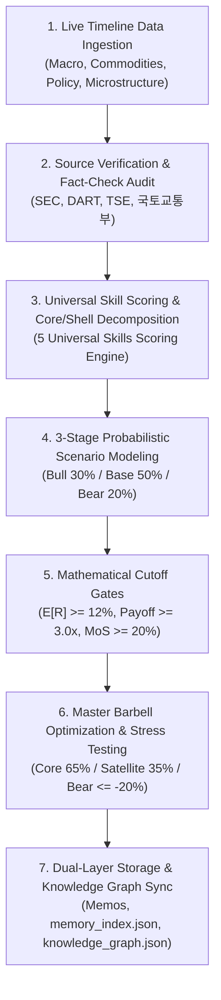

# Multi-Asset Investor Principles & Execution Framework

## 0. The 11-Principle Hierarchical Weighting Matrix

Not all 11 principles carry equal weight. Core fundamental cash flows and land decomposition form the foundational bedrock, while data verification and market microstructure serve as protective and execution layers:

| Hierarchy Level | Principle ID & Description | Assigned Weight | Primary Focus & Role |
| :--- | :--- | :---: | :--- |
| **Level 1: Core Axioms & Economic Moats (35%)** | **P1: Asset Value Decomposition** ($V(t) = \text{Land}(e^{gt}) + \text{Bldg}(0)$)<br/>**P2: 4 Fundamental Criteria** (FCF, Pricing Power, ROIC>WACC)<br/>**P3: 5 Universal Skills** (Absolute Inelasticity, Walled Garden) | **15%**<br/>**12%**<br/>**8%** | **The Indestructible Bedrock:** Permanent compounding, zero shell capital, sovereign cash flows. |
| **Level 2: Capital Velocity & Asymmetry (30%)** | **P4: Small-Seed Velocity & Non-Callable Float Leverage** ($\Pi(t)$)<br/>**P9: 3-Stage Scenarios & Mathematical Cutoff Gates** ($E[R]$, Payoff)<br/>**P10: Master Barbell Allocation & Downside Protection** | **10%**<br/>**10%**<br/>**10%** | **The Growth & Compounding Engine:** 0% margin call leverage, asymmetric payoffs, strict downside lock. |
| **Level 3: Market Dynamics & Policy Harness (20%)** | **P5: Market Microstructure & Time-Horizon Arbitrage**<br/>**P6: Global Policy Transmission Engines** (IRA 45U, TSE, Value-Up)<br/>**P7: Global Multi-Asset Universe & 10억 이하 자산 사다리** | **7%**<br/>**7%**<br/>**6%** | **The Macro & Execution Moat:** Exploiting quant/algo cascades, government subsidy tailwinds. |
| **Level 4: Data Verification & System Integrity (15%)** | **P8: Dynamic Timeline Ingestion & Tier-1 Regulatory Verification**<br/>**P11: 7-Step Workflow & Knowledge Graph Topological Integrity** | **10%**<br/>**5%** | **The Shield of Truth & Integrity:** 100% SEC/DART/국토교통부 1차 출처 검증, zero hallucinations. |
| **TOTAL** | **11 Institutional Principles** | **100%** | **Unbreakable Multi-Asset Capital Allocation System** |

---

## 1. Core Definition & The Fundamental Value Axiom

A truly valuable investment asset is **NOT** simply an asset that is famous or has risen in price historically. It is defined as:

> **"An asset with predictable and expandable future cash flows, asymmetric risk-reward profile (limited downside vs. open upside), and a rigorous margin of safety purchased during market mispricing or structural transitions."**

### 📐 The Fundamental Valuation Axiom:
Every asset is decomposed into its **Compounding Core** and **Depreciating Shell**:

$$V(t) = \underbrace{V_{\text{Core}}(0) \cdot e^{g \cdot t}}_{\text{Compounding Permanent Core (Land/Bottleneck/IP)}} + \underbrace{V_{\text{Shell}}(0) \cdot \max(0, 1 - \delta \cdot t)}_{\text{Depreciating Shell (Buildings/Capex/Legacy Hardware)}}$$

* **Winning Strategy:** Minimize capital paid for the decaying shell (\(\delta \to 0\)) and maximize ownership of the permanent, price-inelastic core (\(e^{g \cdot t}\)).

---

## 2. The 4 Fundamental Investment Criteria

Every asset candidate must pass the following 4 pillars:

### ① Sustainable & Expandable Cash Flow & Economic Moat
* **Discounted Future Free Cash Flows (FCF):** Intrinsic value equals the net present value of all future cash flows.
* **Pricing Power:** Ability to pass through inflation and cost increases to consumers without losing market share.
* **High Capital Efficiency (ROIC > WACC):** High return on invested capital reinvested at high rates.
* **Economic Moat:** Brand power, network effects, high switching costs, or irreproducible cost advantages.

### ② Asymmetric Risk-Reward & Margin of Safety
* **Downside Inelasticity vs. Upside Convexity:** In the Bear Case, downside is structurally protected by liquidation value, hard asset replacement cost, or price-insensitive buyers. In the Bull Case, massive re-rating is unlocked.
* **Market Mispricing:** Exploiting short-term algorithmic noise, liquidity crunches, or information asymmetry to buy well below intrinsic value.

### ③ Structural Megatrends & Anti-fragility
* **Macro Tailwinds:** Alignment with irreversible multi-decade trends (AI Compute Physicalization, Power Grid Deficit, Fiscal Dominance, Deglobalization/Rearmament).
* **Anti-fragility:** Benefiting from macro volatility, recessions, or competitor liquidations to consolidate market share.

### ④ Capital Allocation & Governance
* Management/Protocol governance aligned with shareholder value: Reinvesting in high-ROI projects, aggressive share buybacks/token burns, and progressive dividends rather than empire-building M&A.

---

## 3. The 5 Universal Investment Skills

```
[The 5 Universal Investment Skills]
1. Asset Decomposition (Shell vs. Core) : Separate decaying wrappers from compounding land/core.
2. Absolute Supply Inelasticity (E_s ≈ 0) : Physical or regulatory barriers where supply cannot expand.
3. Price-Inelastic Buyer Cohort : UHNWI Top 0.01% or mission-critical corporate cash flows.
4. Walled Garden & Privacy Moat : Closed, exclusive, high-trust topologies with high switching barriers.
5. Spillover Arbitrage (Infrastructure Free-Riding) : Capturing massive adjacent Capex without paying for it.
```

---

## 4. Small-Seed Capital Velocity, Non-Callable Float, & Asymmetric Leverage

For an investor starting with a **small seed capital (\(\text{Seed}_0\))**, maximizing long-term terminal wealth \(\Pi(t)\) requires optimizing capital velocity (\(f\)) and non-callable float leverage (\(L\)):

$$\Pi(t) = \text{Seed}_0 \cdot \prod_{k=1}^{f \cdot t} \left(1 + L_k \cdot R_{\text{cycle}, k}\right)$$

### 🔑 Why Real Estate Worked for the Masses (The Jeonse & Policy Put):
1. **Non-Callable Leverage (마진콜 0%):** Unlike equity margin debt or crypto perps that trigger intraday liquidation during Flash Crashes, real estate debt and **Jeonse (전세) deposits** cannot be called intraday.
2. **0% Interest Operating Float (무이자 선수금):** Jeonse acts as 0% interest corporate operating float, allowing 2~3x leverage without daily carry cost.
3. **Implicit Government Downside Put:** When housing crashes, governments lower rates, provide mortgage restructuring, and stimulate demand to prevent systemic bank insolvency.

### 🚀 Equity & Multi-Asset Translation (Small-Seed Weaponry):
* **Non-Callable Equity Derivatives:** Utilize deep in-the-money long-dated call options (LEAPS with 2+ yr expiry) or cash-secured asymmetric bets to gain defined-risk convex leverage without daily liquidation risk.
* **Corporate Operating Float:** Invest in businesses with negative working capital and massive advance deposits (e.g., Kweichow Moutai 100% advance payments, Costco prepaid memberships, Meritz insurance float).
* **Satellite Re-Rating Harvesting (\(f \uparrow\)):** In the Satellite bucket, harvest gains once an industrial bottleneck asset achieves a +100% ~ +150% multiple expansion, recycling the realized capital into undervalued Core assets to accelerate compound frequency \(f\).

---

## 5. Market Microstructure, Algorithmic Trading, & Time-Horizon Arbitrage

Modern financial markets are 70~80% dominated by algorithmic and quantitative execution:
* **HFT & Market Makers:** Exploit milliseconds of latency; provide liquidity in calm regimes but withdraw liquidity during volatility spikes.
* **CTA & Trend Following Bots:** Mechanically short assets breaking below 50D/200D Moving Averages, causing exaggerated liquidity cascades.
* **Multi-Manager Pod Shops (Point72, Millennium):** Enforce strict -3% to -5% risk-limit stop-outs, dumping pristine fundamental assets regardless of intrinsic value.
* **0DTE Options Gamma Hedging:** Market-maker delta hedging causes violent intraday overshoot beyond fundamental reality.

### 🛡️ Exploitation Strategy (Time-Horizon Arbitrage):
1. **Time-Horizon Arbitrage:** While quant algorithms operate on millisecond-to-monthly horizons with rigid stop-outs, the fundamental investor exploits a **3 to 10-year holding horizon**, absorbing forced algorithmic selling at extreme discounts.
2. **Flash Liquidity Provision (Opportunistic Limit Orders):** Place staggered limit bids at deep discounts (e.g., -15% to -25% below intrinsic value) to catch cascade selling from algorithmic stop-outs.

---

## 6. Global Politics & Policy Transmission Engines

Government policy is a primary driver of asset class returns and capital flows:
1. **Direct Subsidies & WACC Suppression:** US IRA 45U (Nuclear Production Tax Credit of $15/MWh floor), US CHIPS Act, NATO 2% GDP defense spending mandate.
2. **Regulatory Moats & Supply Freezes:** NRC nuclear licensing barriers, strict zoning laws in prime urban centers, US Biosecure Act locking out foreign competitors.
3. **Mandatory Shareholder Returns & Capital Market Reforms:**
   * **Japan TSE PBR 1x Mandate:** Tokyo Stock Exchange penalizing sub-1x PBR firms, forcing record share buybacks and cross-shareholding unwinding.
   * **Korea Corporate Value-Up Program:** Tax incentives and regulatory pressure rewarding high-ROE, high-cancellation firms (e.g., Meritz model).
   * **China State Council 'Nine Measures' (新国九条):** Forcing state-owned and private firms to increase dividend payouts and delisting chronic non-payers.

---

## 7. Comprehensive Multi-Asset Universe & 10억 이하 자산 사다리

```
[ Global Multi-Asset Universe Taxonomy ]
• US Equities: MSFT, NVDA, AVGO, CEG, LLY, AMZN, COST (INTC = Disqualified)
• Korea Equities: Samsung Elec (005930), SK hynix (000660), HD Hyundai Elec (267260), LS Electric (010120),
                 HD Korea Shipbuilding (009540), Hanwha Aero (012450), Samsung Bio (207940), Samyang Foods (003230),
                 Meritz Financial (138040) (Kakao = Disqualified)
• Japan Equities & ETF: Mitsubishi Corp (8058.T), Keyence (6861.T), DISCO (6146.T), Advantest (6857.T),
                       TIGER Japan Semiconductor FACTSET ETF (463050.KS) (Nissan = Disqualified)
• China Equities & ETF: Kweichow Moutai (600519.SH), Tencent (0700.HK), CATL (300750.SZ), BYD (1211.HK),
                       TIGER China Semiconductor FACTSET ETF (396500.KS) (Vanke = Disqualified)
• Commodities & Hard Assets: Cameco (CCJ), Freeport-McMoRan (FCX), Cheniere Energy (LNG), BHP Group (BHP),
                            Frontline (FRO), Physical Allocated Gold (XAU)
• Crypto & RWA: Bitcoin (BTC / Digital Gold), Ethereum (ETH / Settlement Layer), Solana (SOL / Agent Layer)
• Prime Real Estate & Land: Hannam UN Village, Apgujeong Hyundai, Banpo One Bailey, Seongsu Waterfront IT,
                           Yeouido Finance, Yongsan Master Land, Manhattan Central Park, 500MW DC Land, US Farmland
• Sub-10억 수도권 자산 사다리: 노원 상계주공 (6.8억), 용산 원효로 빌라 (8.5억), 분당 선도지구 (9.2억), 광명뉴타운 (7.8억)
```

---

## 8. Dynamic Timeline Ingestion, Fact-Checking & Source Verification Protocols

Before executing any valuation, screening, or portfolio rebalancing pipeline, the agent **MUST** refresh live timeline feeds and audit source citations:
1. **Macro & Interest Rates:** US 10Y Yield, DXY, Global M2 YoY (FRED / US Treasury).
2. **Commodity Benchmark Feeds:** LME Copper ($/lb), UxC Uranium ($/lb), LBMA/CME Gold ($/oz), Henry Hub Gas ($/MMBtu).
3. **Regulatory & SEC/DART Filings:** SEC EDGAR Form 10-K/Q, DART 반기보고서, JPX EDINET, SSE 공시.
4. **Real Estate Transaction Registry:** 국토교통부 실거래가 공개시스템, 서울시 부동산 정보광장, 대법원 인터넷등기소.
5. **Data Source Verification Registry:** All data points must be verified and logged in `data/timeline/verified_sources.json` with Tier-1 citations.

---

## 9. 3-Stage Probabilistic Scenario Modeling & Mathematical Cutoff Gates

Every asset is modeled through a rigorous 3-stage probability distribution:

| Scenario | Standard Probability | Valuation Multiple Assumption | Catalysts / Drivers |
| :--- | :---: | :--- | :--- |
| **Bull Case** | **30%** | Peak Historical Multiple + Multiple Expansion | Megatrend acceleration, monopoly pricing power, blowout EPS |
| **Base Case** | **50%** | Median FCF / 10-Yr Historical Multiple | Steady-state business execution and consensus FCF |
| **Bear Case** | **20%** | Trough Multiple / Liquidation Land Value | Severe macro recession, regulatory pressure, supply shock |

### 🛑 Hard Cutoff & Qualification Gates:
1. **Probability-Weighted Expected Return Gate:**
   $$\mathbb{E}[R] = 0.30 \cdot R_{\text{Bull}} + 0.50 \cdot R_{\text{Base}} + 0.20 \cdot R_{\text{Bear}} \ge 12.0\% \text{ (Hurdle Rate)}$$
2. **Asymmetric Payoff Ratio Gate:**
   $$\text{Payoff Ratio} = \frac{\mathbb{E}[\text{Gain}]}{\mathbb{E}[\text{Loss}]} = \frac{0.30 \cdot R_{\text{Bull}} + 0.50 \cdot R_{\text{Base}}}{0.20 \cdot |R_{\text{Bear}}|} \ge 3.0\text{x}$$
3. **Margin of Safety Gate:**
   $$\text{Margin of Safety} = \frac{\text{Intrinsic Value}_{\text{Base}} - \text{Current Price}}{\text{Intrinsic Value}_{\text{Base}}} \ge 20.0\%$$

---

## 10. Master Barbell Portfolio Allocation & Downside Protection Protocol

The Master Barbell Portfolio structures capital into two distinct buckets while keeping a liquidity buffer:

```
┌─────────────────────────────────────────────────────────────────────────┐
│                      MASTER BARBELL ALLOCATION MATRIX                   │
├────────────────────────────────────┬────────────────────────────────────┤
│         CORE BUCKET (60~70%)       │      SATELLITE BUCKET (30~40%)     │
│   [Non-Cyclical Compounding Moats] │  [Industrial Bottlenecks & Asymmetry]│
├────────────────────────────────────┼────────────────────────────────────┤
│ • Geographic / Spatial Land Monopolies│ • AI Silicon & Interconnects (NVDA/AVGO)│
│ • Unleveraged High Land Share Plots │ • Wafer Dicing Monopolies (DISCO/TEL)│
│ • Digital Gold & Hard Reserves (Gold/BTC)│ • 24/7 Nuclear & Power Grid (CEG/CCJ)│
│ • High-FCF Monopolies (MSFT/LLY/Moutai)│ • Power Distribution & Transformers│
│ • 50% Capital Allocation Machines  │ • High-Velocity Growth Satellites   │
├────────────────────────────────────┴────────────────────────────────────┤
│ • Cash / Short-Term T-Bill Buffer (5%): Systematic Flash Crash Hunter   │
└─────────────────────────────────────────────────────────────────────────┘
```

### 🛡️ Downside Risk Protection Rules:
1. **Core Bucket Volatility Dampening:** Core assets must experience maximum drawdown \(\le 10\%\) during severe stress.
2. **Synchronized Bear Case Stress Test:** Under a simultaneous Bear Case event across all holdings, total portfolio drawdown **MUST NOT exceed 20.0%**:
   $$\text{Max Bear Drawdown} = \sum_{i=1}^{N} w_i \cdot R_{\text{Bear}, i} \ge -20.0\%$$
3. **No Unhedged Ruin Exposure:** Zero allocation to structurally fragile companies (ROIC < WACC, balance-sheet debt traps, unbacked tokenomics).

---

## 11. Execution Workflow & Output Artifact Standardization

When conducting investment research, the Investor Agent must follow this 7-step execution loop:


